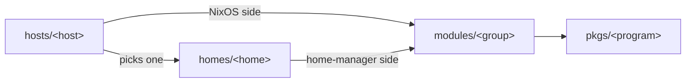

# Guiom's dotfiles

My NixOS machines, my home-manager configs, and the tools I wrote for them.

## Machines

| Host         | What                                         | Home               |
| ------------ | -------------------------------------------- | ------------------ |
| `badlands`   | work laptop                                  | `work-laptop`      |
| `granary`    | Framework laptop, work                       | `work-laptop`      |
| `snakewater` | gaming and dev desktop, streams with Sunshine | `personal-desktop` |
| `gullywash`  | home server: ZFS storage, Docker services    | `server`           |

## Using it

On one of the machines above, rebuild from the clone in `~/dotfiles`:

```bash
nh os switch                                  # or: sudo nixos-rebuild switch --flake .#<host>
```

A home on its own, on a machine that does not run NixOS:

```bash
home-manager switch --flake .#guillaume       # a Linux box without a screen
home-manager switch --flake .#codspeed        # CodSpeed's mac mini
./scripts/bootstrap-headless.sh               # any headless box, as whoever runs it
```

The installation ISO:

```bash
nix build .#nixosConfigurations.guiom-nixos-installation.config.system.build.isoImage
```

`just check` runs every linter and test suite, `just format` formats everything.

## How it is laid out



- `flake.nix` lists every file that defines something, so it doubles as a table of contents.
- `hosts/<host>/` is one machine. Its `default.nix` says what the machine is made of: the
  groups it has and the home its user gets. `configuration.nix` and the other files there
  are what is true of that machine alone.
- `homes/` holds one complete home-manager config per role. A host picks one; the ones
  without a host are built on their own (`.#guillaume`, `.#codspeed`, `.#headless`).
- `modules/` holds the groups hosts and homes mix and match. A group can have a NixOS side,
  a home-manager side, or both, in the same directory:
  - `core`: what every machine and every home has (nix, my user, home-manager, theme)
  - `shell`: the terminal (zsh, zellij, git, editors, CLI tools)
  - `desktop`: a machine I sit in front of (GDM, niri, the quickshell bar, apps)
  - `work`: CodSpeed tooling, and `work-desktop` for what a work machine with a screen adds
  - `laptop`, `encrypted-disk`, `secure-boot`, `stall-tracing`
- `pkgs/` holds the programs I wrote (`wt`, `reviews`, `omp-panel`, the niri helpers…), each
  available everywhere as `pkgs.<name>` and buildable with `nix build .#<name>`.
- `nvim/` is my neovim config. It stands on its own; the nix config only links it to
  `~/.config/nvim`.
- `ai/` is the config of my coding agent (omp): rules, skills, extensions.

To add a host, a group or a program: create its directory, then add one line to
`flake.nix` (hosts and groups) or to `pkgs/default.nix` (programs).
